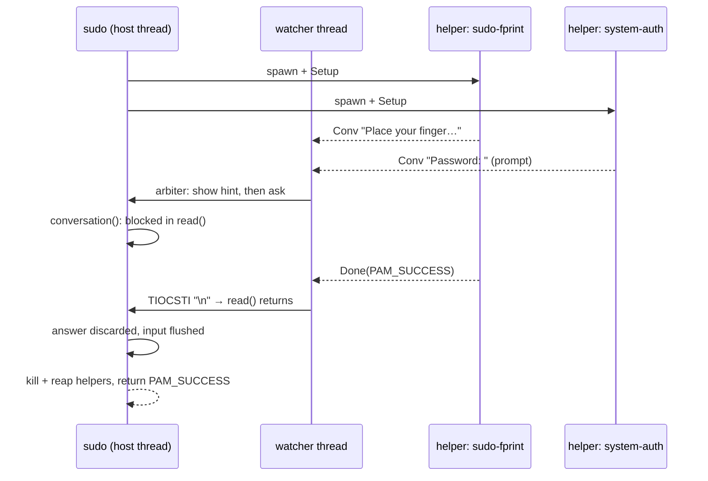

# pam-race

A PAM module that runs several PAM services **concurrently** and succeeds as soon as one of them does. It was written so that `sudo` takes a password **or** a fingerprint, whichever you give first, without the usual timeout before the password prompt shows up.

```
auth  required  pam_race.so  sudo-fprint  system-auth
```

Each argument names a regular `/etc/pam.d` service. Each one's `auth` stack runs in its own helper process, and the module connects all of them to the application's conversation function.

## Why not the existing approaches

`pam_fprintd` followed by `pam_unix` is **sequential**: you get the password prompt only after the fingerprint attempts fail or time out.

Linux-PAM won't run modules in parallel ([linux-pam#301](https://github.com/linux-pam/linux-pam/issues/301): it would take a redesign nobody has proposed). Graphical login and lock screens solve it themselves by running one PAM service per method side by side (GDM, KScreenLocker, Plasma Login Manager). Terminal hosts don't: sudo, sudo-rs and su run a single blocking conversation, with no support for `PAM_CONV_AGAIN`. pam_race brings the same model to them from inside the stack.

The parallel options available so far all get stuck on the same problem. When the fingerprint matches while the application is blocked in `read()` waiting for the password, something has to make that `read()` return:

* **Interrupting it with a signal** (pam_hybrid_auth's `SIGUSR1`) doesn't work with sudo. Its conversation function treats an interrupted read as ^C and returns `AUTH_INTR` even when the PAM stack succeeded (`getpass_error` in `plugins/sudoers/auth/pam.c`).
* **Cancelling the thread** (`pthread_cancel`, used by pam-fprint-grosshack; pam-parallel cancels asynchronously) unwinds through sudo's `tgetpass`, libpam or a module without restoring the terminal or releasing what they hold.
* **Abandoning the thread** (pam-any) leaves it blocked in the application's `read()` after authentication has finished, where it can still swallow keystrokes. The terminal echo is then repaired by hand.

pam_race does what a user would do and **ends the line**. It pushes a newline into the terminal's input queue with `TIOCSTI`, so the application's `read()` returns normally and the half-typed answer is discarded. Whatever pushed input the application didn't read is flushed (`TCIFLUSH`) before control goes back to it.

## Design



The code is a **functional core inside an imperative shell**. Every boundary is parsed into a type once, and nothing past that point re-checks it:

| Core (pure, unit-tested) | |
|---|---|
| `types.rs` | `PamError`/`PamResult`, `Style`, `Text`, `Messages` (1–32), `Responses` (exactly one per message), `ServiceName`, `AbsPath`, `UserName`, `ItemValue` (≤ 4096 bytes), `AuthFlags`, `Secret` (wiped on drop), `TtyState` (background / line queued / idle) |
| `config.rs` | module arguments → `Config` |
| `proto.rs` | helper wire format, encode/decode |
| `arbiter.rs` | the race rules and the release of obsolete prompts, as a state machine: no I/O, no clock reads, no threads |

| Shell | |
|---|---|
| `lib.rs` | PAM entry points |
| `race.rs` | host thread + watcher thread around the arbiter |
| `spawn.rs` | `clone3`/pidfd process management |
| `tty.rs` | `TIOCSTI`, flush, notice |
| `wire.rs` | socket transport |
| `bin/helper.rs` | the helper |

### Process model

* **Helpers are fork+exec'd** (`pam-race-helper`), not threads. PAM modules aren't written to run concurrently inside one process. Isolation is free, and cancelling a helper is just `SIGKILL`; with pam_fprintd, fprintd sees the D-Bus peer disappear and releases the reader.
* **Spawning goes through a keeper.** The module's own child is a *keeper*, created with raw `clone3(CLONE_PIDFD)` and `exit_signal = 0` (or `clone()` where a seccomp filter fails `clone3` with `ENOSYS`, as container runtimes do). It never execs, because `execve()` resets the exit signal to `SIGCHLD`. So the host never gets a `SIGCHLD`, and neither its `waitpid(-1)` nor `SIGCHLD = SIG_IGN`/`SA_NOCLDWAIT` can reap or auto-reap the keeper: both only apply to children whose exit signal is `SIGCHLD`. Signalling and reaping go through the keeper's pidfd (`pidfd_send_signal`, `waitid(P_PIDFD)`).
* **The keeper cleans up after the helper.** It is a child subreaper and forks the helper into a process group of its own. When the helper exits, or when the module asks it to (`SIGTERM`, taken with `sigwaitinfo`), it kills the helper's group, then every process it has inherited until it has no children left: as a subreaper it inherits every descendant whose parent dies, including those that left the group (`pam_exec` children `setsid()` themselves). It reaps them all before it exits. Nothing the helper started is left for the host, even a host that is a subreaper itself. The group kill can't hit a recycled PGID: the helper isn't reaped before it. The keeper's pidfd turns readable when it exits, even if something the helper started kept the socket open. A keeper that hasn't finished within a second (a process stuck in uninterruptible sleep) is killed.
* **Before execve**, the keeper (for its whole life) and the helper only make async-signal-safe syscalls on memory prepared before the clone, which matters for multi-threaded hosts. Every step is checked; any failure ends the helper before it runs. The keeper keeps every signal blocked, so no host handler ever runs in it. Between them they:
  * call `setsid()`, so there is no controlling terminal and no module can read the user's keystrokes;
  * put stdio on `/dev/null` and the socket on fd 3;
  * run `close_range(4, ~0)` (the keeper then closes everything, so the socket's EOF is the helper's alone);
  * set `PR_SET_PDEATHSIG` (keeper: with the host thread; helper: with the keeper) and check the parent PID;
  * reset `SIGCHLD` in the keeper (a host's `SIG_IGN` would auto-reap the helper), and every signal disposition and the signal mask in the helper;
  * pass on a minimal environment: `PATH`, and the locale variables (`LANG`, `LANGUAGE`, `LC_ALL`, `LC_MESSAGES`, `LC_CTYPE`) whose values are plain locale names (no `/`, no leading `.`, ASCII only).
* **Hardening in the helper:** `PR_SET_DUMPABLE=0` (it holds passwords: no core dumps, no ptrace by the invoking user), `FD_CLOEXEC` on the socket so nothing a module runs inherits it, and a recursion guard (`PAM_RACE_NESTED`). Responses travel in `Secret` buffers that are wiped with `explicit_bzero`. The helper calls `setlocale(LC_ALL, "")`, as an application would, so modules' gettext messages come out in the user's language.
* **Identity.** A sub-stack's success counts only if its `PAM_USER` is still the user the module asked about. The outer handle keeps that user, so a sub-stack that maps or canonicalizes the name authenticated someone else; its success becomes `PAM_AUTH_ERR`. `PAM_TTY`, `PAM_RHOST` and `PAM_RUSER` are copied into every sub-stack (up to 4096 bytes each; a longer one fails the module), and failing to set one fails the sub-stack.
* **Threads.** The host thread is the only one that touches the PAM handle or calls the host's conversation function. The watcher thread reads the helper sockets and releases obsolete prompts, and it is created with **all signals blocked**, so the host's ^C still interrupts its own `read()`.
* **Transport** is an `AF_UNIX`/`SOCK_SEQPACKET` socketpair: atomic packets, EOF on death, `MSG_NOSIGNAL` on send, and oversized packets are detected with `MSG_TRUNC`. Answers are capped at 4096 bytes so a reply always fits one packet. A longer answer is a conversation error, and a reply that cannot be sent takes its helper out of the race instead of leaving it waiting.
* **Bounded backlog.** Helpers don't wait for informational messages to be shown. Once 16 conversation calls from one helper are waiting for the host (e.g. while the user sits at another helper's prompt), its further informational messages are dropped. Its socket is still read, so its result is seen right away; prompts are never dropped.

### Race rules (`arbiter.rs`)

1. The first helper to succeed wins.
2. If a helper fails **after the user answered one of its prompts**, the race ends with that error. For example, a wrong password ends this attempt, so sudo prints "Sorry, try again" right away instead of waiting on the fingerprint reader.
3. Otherwise the race fails once every helper has failed. The result is their common error, or `PAM_AUTH_ERR` if they differ.
4. A conversation error on a prompt (^C, EOF, `sudo -n`, a cancelled dialog) cancels the race.
5. Prompts are held for up to `settle` ms until every helper has said something, so "Place your finger on the fingerprint reader" appears *before* the password prompt blocks the conversation. Informational messages always go ahead of queued prompts.
6. Once the user has answered a prompt, only that helper's messages are shown. Once the race is decided, only the deciding helper's messages are shown (everyone's if everyone failed).
7. A prompt is released once it is obsolete: the race is decided, or the helper that asked is gone. Its answer is discarded, and the user is not committed to a helper that is gone, so the others stay in the race.
8. While the host is blocked in a prompt, its conversation can't show anything else. What another helper says meanwhile, or that it stopped (a fingerprint reader timing out), is written at the right end of the prompt's line, and the cursor put back: `sudo-fprint stopped: Verification timed out`. Only while the host owns the terminal, and only on a terminal with cursor control (`TERM` set, not `dumb`).

## Configuration

```
auth  required  pam_race.so  [debug] [settle=MS] [helper=PATH] [confdir=DIR] SERVICE...
```

| Option | Default | Meaning |
|---|---|---|
| `debug` | off | Log race events to syslog (`LOG_AUTHPRIV`). |
| `settle=MS` | 600 | Longest a prompt waits for the other helpers' first message (max 5000). |
| `helper=PATH` | `/usr/lib/pam-race/pam-race-helper` | Helper binary (absolute path). |
| `confdir=DIR` | libpam's | Where the sub-services' files live (`pam_start_confdir`). |
| `SERVICE...` | — | One or more service names; each is a plain file name, given once. |

### Example: sudo with password or fingerprint

`/etc/pam.d/sudo-fprint`:

```
#%PAM-1.0
auth  required  pam_fprintd.so
```

`/etc/pam.d/sudo`:

```
#%PAM-1.0
auth      optional  pam_env.so
auth      [success=done service_err=ignore system_err=ignore module_unknown=ignore open_err=ignore symbol_err=ignore default=die]  pam_race.so  sudo-fprint system-auth
auth      include   system-auth
account   include   system-auth
session   include   system-auth
session   optional  pam_systemd.so class=none
```

`system-auth` runs as one sub-stack, with `pam_faillock`, `pam_unix` and the rest. How the control field works:

* **Success** ends the auth stack (`done`).
* **A real authentication failure or a cancel** fails it (`default=die`).
* **pam_race failing to run** (module missing, helpers unable to start) is ignored, and the plain `system-auth` password stack takes over. A broken install cannot lock you out of sudo.

Sub-stacks only run their **authenticate** phase, so modules that act in `setcred`, such as `pam_env`, belong in the outer stack before `pam_race` (hence the `pam_env` line).

`pam_fprintd` gives up after `timeout=` seconds (default 30) or `max-tries=` failed matches (default 3); the fingerprint is then out of this attempt, and the password prompt says so beside it. A longer `timeout=` (or `-1`, none) in `sudo-fprint` keeps the reader waiting as long as sudo does, but holds it meanwhile: fprintd lets one client at a time use a reader, so a lock screen can't take a fingerprint until sudo is done.

On CachyOS the `pam_fprintd` line in `/etc/pam.d/sudo` is managed by `chwd` (`# chwd-fprintd`). Re-applying the fprint profile may add it back, which would put the sequential fingerprint step in front again.

Keep a root shell open while you change `/etc/pam.d/sudo`.

## Limitations

* **Releasing a pending prompt needs `TIOCSTI`.** With `dev.tty.legacy_tiocsti = 0` (the default since Linux 6.2) that needs `CAP_SYS_ADMIN`, which setuid hosts like sudo, sudo-rs and su have. Other hosts print "Authenticated by …. Press Enter to continue." instead (or "… stopped." if the helper that asked is gone).
* **Don't use it for polkit (`polkit-1`: pkexec, run0, GUI authentication dialogs).** There the PAM host is `polkit-agent-helper-1`, whose conversation reads answers from the authentication agent over a pipe, not from a terminal. A prompt can't be released and no notice can be shown: after a fingerprint wins, the agent's password field stays open, with no explanation, until it is answered. The same goes for any host whose prompt isn't read from the terminal (a GUI dialog). GUI greeters and lock screens run several PAM conversations themselves and don't need this module.
* **Releasing a prompt is best effort, not a cancellation.** The module can't tell whether the host's prompt reads the terminal, and the terminal's input queue is shared with every process that reads it. Whichever reads first takes the pushed newline as Enter. So a newline is only pushed while the host is in the terminal's foreground process group: a background host (`sudo -A cmd &`) isn't reading it, and the shell that is would run a half-typed command line. Even then another foreground reader may take it: `sudo cmd | less`, for example, where sudo and less already compete for the terminal. A newline is also only pushed when no complete line is queued. In canonical mode a half-typed line doesn't count, so it is completed and submitted, to the host if it is the reader (which discards it). Up to six newlines are pushed over about 1.3 s, never with one still unread; one left unread at the end is flushed, along with any typed-ahead input.
* **Nothing from a sub-stack reaches the outer handle.** PAM items and environment variables a sub-stack sets, including `PAM_AUTHTOK`, stay in the helper. Modules that rely on them later in the outer stack (e.g. `pam_gnome_keyring`) won't see them. A sub-stack that changes `PAM_USER` can't win at all (see Identity above).
* **The keeper is a copy of the host.** It is forked from the host and never execs, so for the length of the race the kernel copies each page the host writes to (copy-on-write). Negligible for sudo-sized hosts.
* **Processes a helper starts don't outlive it.** The keeper kills everything it inherits, including processes that left the helper's session. A sub-stack module that starts a daemon meant to persist loses it. A process the keeper may not signal (one that ran a setuid program under a non-root host) survives; after a second the keeper is killed and leaves it to the next subreaper. Without `/proc` (`/proc/thread-self/children`), only the helper's process group is killed.
* **Requirements:** Linux ≥ 5.9 (`clone3` or `clone` with `CLONE_PIDFD`, pidfd `waitid`, `close_range`) and Linux-PAM ≥ 1.4 (`pam_start_confdir`).

## Build, test, install

```sh
make                 # release build; the helper path is baked in at build time
make check           # unit tests + end-to-end tests on a pseudo-terminal
sudo make install    # /usr/lib/security/pam_race.so, /usr/lib/pam-race/pam-race-helper
```

The end-to-end tests (`tests/race.rs`) run a sudo-like host (`testing/host.rs`) on a pty against `pam_exec` stand-ins, and need no root and no PAM configuration changes. The host reaps any child it can (as sudo does) and is a child subreaper (as service managers are), and the tests check it never gets one of pam_race's processes, and that pam_race returns with no process left. The prompt tests run twice, with the host reading the password like sudo (canonical mode, `TCSAFLUSH`) and like sudo-rs (byte by byte in non-canonical mode, `TCSANOW`). Failure paths are tested by fault injection: the host can install a seccomp filter that makes `setsid`, `close_range`, `sendto` (optionally only for one length) or `clone3` fail with `EPERM` or `ENOSYS`. As non-root the tests exercise the "Press Enter" fallback. To exercise the `TIOCSTI` path with both readers, run the built test binary as root:

```sh
cargo test --no-run 2>&1 | grep -o 'target/debug/deps/race-[0-9a-f]*'
sudo ./target/debug/deps/race-<hash>
```
